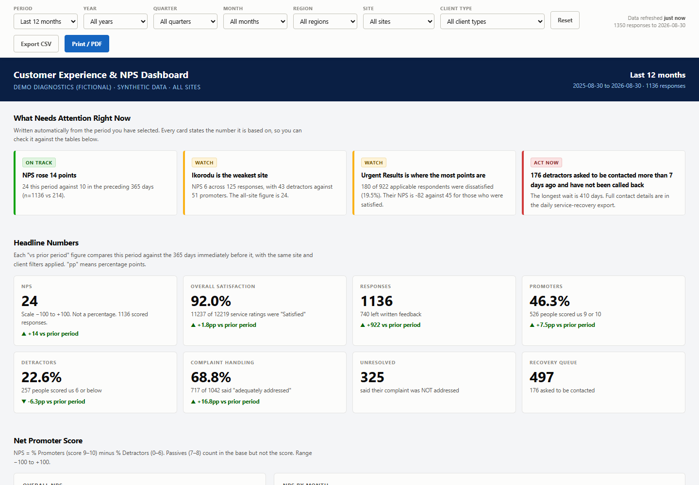
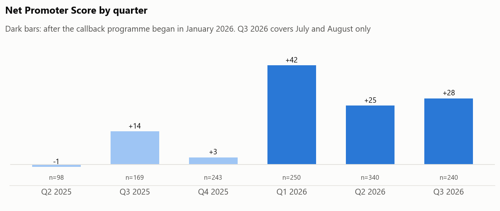
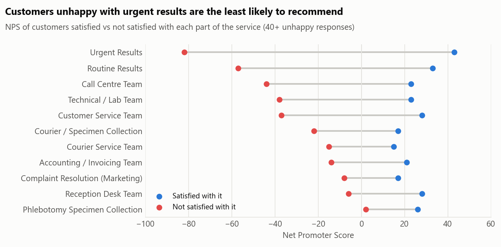

# Customer experience and NPS: survey pipeline and dashboard

> **In short:** A diagnostic lab collects customer feedback through an online form: how likely people are to recommend it, how they rated each part of the service, and what went wrong. I built a pipeline that cleans every new batch of responses, works out the scores, sorts the comments into themes, lists the unhappy customers who asked to be called back, and publishes a dashboard managers can read without any training. Personal details never reach the published page.
>
> On this demo data, the analysis shows that slow urgent results drive most of the unhappiness, and that a callback programme lifted the score from +6 to +31. It also shows that the form's own "complaints resolved" figure overstated how many complaints were really fixed. **What it shows:** I build reporting that people act on, and I check whether a headline number means what it seems to.

I built this for the customer-relations team at my workplace, where it runs every day on real survey responses. This public version runs the same pipeline on **synthetic data**: 1,350 invented responses for a fictional ten-branch lab network. No real customers, branches or comments are included.

**[Open the live dashboard →](https://yusuf-tiamiyu.github.io/nps-customer-experience/)**



## What the data shows

Net Promoter Score (NPS) is the share of customers who would recommend you (scores 9–10) minus the share who wouldn't (0–6). It runs from −100 to +100 and is not a percentage.



**1. A callback programme turned the score around.** NPS was +6 before January 2026, when the network began texting results and calling back unhappy customers, and +31 afterwards. Complaints about the call centre fell from 17.6% of the customers who used it to 5.8%, and complaints about urgent results from 28.6% to 16.6%.



**2. Slow urgent results are the biggest single problem.** One in five customers who needed urgent results (21.1%) were unhappy with them, and their NPS is −82, against +43 for customers who were happy with them. 60% of all detractors were unhappy with urgent results, and "turnaround time / result delay" is the most common theme in written comments.

**3. Ikorodu is the branch to fix first.** It has the lowest NPS (+5). Its customers were unhappy with urgent results twice as often as at the other branches (37.5% against 19.1%).

**4. Referring clinics are much harder to please than walk-in patients.** NPS is +33 for walk-ins and +6 for clinics and companies that send samples in. Those accounts depend most on fast results and collection, so they feel delays first.

**5. The form's "complaints resolved" figure overstates the truth.** 66.1% of people answered "Yes" to *"Were your complaints adequately addressed?"*, but half of those Yes answers (49.1%) came from people who had nothing to complain about. Among customers who were actually unhappy with something, 51.1% said their complaint was addressed. That rose from 40.1% to 59.2% after the callback programme. A better form would only ask that question to people who had a complaint.

All of these numbers come from [`analysis/analyse.py`](analysis/analyse.py), which reads the dashboard's own output (`dist/data.json`), so the write-up and the dashboard can't disagree. They are saved in [`analysis/findings.json`](analysis/findings.json).

## How the pipeline works

```
Microsoft Forms export (.xlsx)  ->  newest file in Raw_Data/
        |
        |-- unchanged since last run?  ->  stop, nothing rebuilt
        v
  clean and standardise                  etl/transform.js
    · non-breaking spaces, stray whitespace, inconsistent casing
    · 22 typed spellings of branch names -> 11 canonical branches + region
    · "Satisfied" / "Not satisfied" / "Not applicable" normalised
    · "Nil", "N/A", bare emails and phone numbers dropped from comments
    · score 0-10 -> promoter / passive / detractor
    · comments tagged against 10 themes (delay, communication, billing, ...)
    · priority score for the callback queue
        |
        |---------->  private/service-recovery.csv   names, emails, phones; stays local
        v
  personal-data check                    etl/build.js (stops the build if contact data
        |                                 reaches a published field)
        v
  dist/index.html  +  dist/data.json     the dashboard, data built in
```

Decisions worth explaining:

- **Branch names are mapped, not guessed.** People type "Lekki Phase 1", "lekki " and "LEKKI"; all three become Lekki. A bare "Lagos" could mean any of three branches, so it stays as its own row and the Data Quality panel says so.
- **Contact details never reach the public page.** The callback list with names, emails and phones is written to `private/`, which is never published. The build refuses to run if contact data appears in any structured field, and it warns when a customer has typed their own number into a comment.
- **Small numbers are flagged.** Branches with fewer than 10 responses are shown but marked "low base", so nobody ranks a branch on five answers.
- **Targets say where they came from.** The dashboard prints the source of every target, and explains that an NPS target of 90 would almost never be realistic, while 90% satisfaction is.

While building this demo I found and fixed a bug in the original phone-number check: it expected 10-digit numbers, so it missed every Nigerian mobile number (`0803 123 4567` is 11 digits).

## Reproduce

```bash
pip install pandas openpyxl matplotlib numpy
npm install
python generator/generate_survey.py   # writes the synthetic export to Raw_Data/
node etl/build.js --force             # cleans it and builds dist/
python analysis/analyse.py            # findings and charts
node etl/serve.js                     # view the dashboard at http://localhost:4173
```

```
generator/generate_survey.py  synthetic Forms export, same columns and quirks as the real form
etl/config.js                 branch names, question wording, themes, thresholds (the only file to edit)
etl/transform.js              cleaning and derived fields
etl/build.js                  the pipeline: read, clean, check, write
src/template.html             the dashboard
analysis/analyse.py           the findings and charts above
```

Tools: JavaScript (Node.js, SheetJS, Chart.js), Python (pandas, matplotlib) for the synthetic data and analysis.
